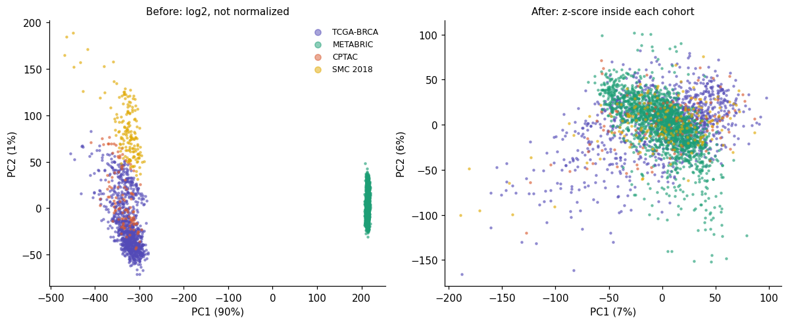
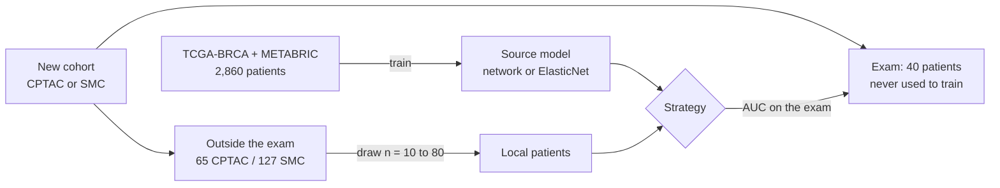
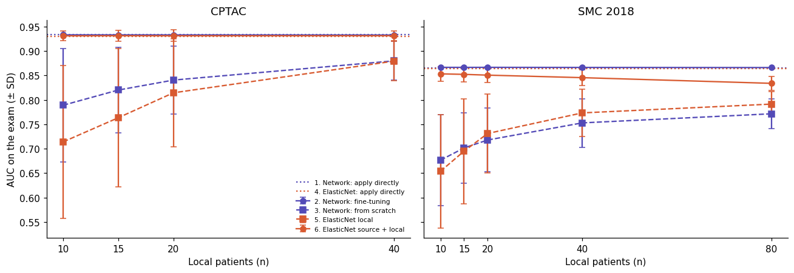
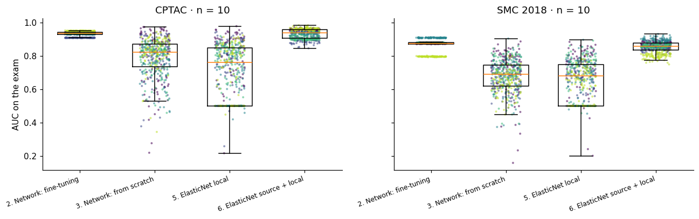
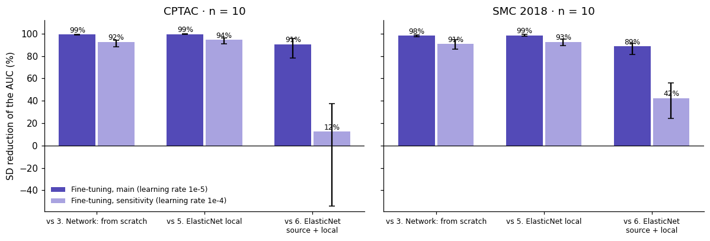
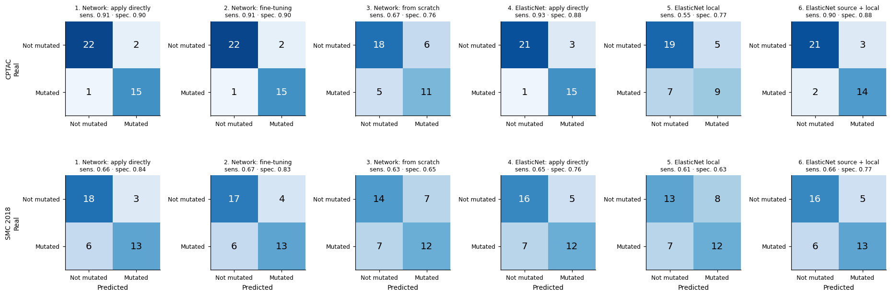

# Transfer learning to predict TP53 status in breast cancer from RNA-seq

This repository contains the code, results and figures of a study on **transfer learning for TP53 mutation prediction in breast cancer**. The study asks whether a model trained on large public cohorts can be moved to a new, small cohort, and how many local patients that new cohort needs. The main outcome is not only how well the models predict. It is how **stable** they are: how much the result changes depending on which few patients were used to train them.


## Contents
1. [The question](#the-question)
2. [Main findings](#main-findings)
3. [Data](#data)
4. [Study design](#study-design)
5. [Results](#results)
6. [Do we answer the questions?](#do-we-answer-the-questions)
7. [Limitations](#limitations)
8. [Repository layout](#repository-layout)
9. [How to reproduce](#how-to-reproduce)
10. [References](#references)

## The question

TP53 is the most frequently mutated gene in breast cancer. Its mutation status can be predicted from gene expression. In a previous study on two small cohorts (CPTAC and SMC 2018), several classical machine learning models reached similar AUCs. But the result and the selected model changed depending on how the patients were split. In other words, with small cohorts the models are **unstable**.

That observation leads to the question of this study:

> Can a TP53 model trained on large breast cancer cohorts (TCGA-BRCA + METABRIC) be moved to a new and different cohort (CPTAC, SMC 2018)? How many local patients does that cohort need for the model to be good and stable?

Here, a **local patient** is a patient of the new cohort whose TP53 status is known and who can be used to adjust the model. A hospital with a new cohort usually has only a few of them.

## Main findings

1. **A model trained on the source cohorts works in a new cohort without any adjustment.** Applied directly, the network reached an AUC of 0.933 in CPTAC and 0.866 in SMC 2018. ElasticNet gave almost the same (0.930 and 0.865).
2. **Adjusting that model with 10 to 80 local patients does not raise the AUC.** The change was 0.004 or less, with the network and with ElasticNet.
3. **Fine-tuning a pretrained network is more stable than ElasticNet trained on the source + the local patients.** Both models learn from the source and from the same local patients. With 10 local patients, the SD of the AUC of fine-tuning was 91% smaller in CPTAC (0.0009 vs 0.0100) and 89% smaller in SMC 2018 (0.0017 vs 0.0151). The difference was significant in each of the 5 exams of both cohorts (Pitman-Morgan test, p < 0.05).
4. **Training only with the local patients gives the lowest AUC and the most variable result.** It did not reach the AUC of applying the source model directly, even with 40 (CPTAC) or 80 (SMC) patients.

## Data

All cohorts are public and come from [cBioPortal](https://www.cbioportal.org). The data are not stored in this repository. `scripts/download_data.py` downloads them, and notebooks 01 and 02 build the matrices.

| Cohort | Role | Platform | Patients | % TP53 mutated |
|---|---|---|---|---|
| TCGA-BRCA (GDC) | Source | RNA-seq (TPM) | 961 | 34.4% |
| METABRIC | Source | Illumina HT-12 microarray | 1,899 | 34.7% |
| CPTAC (GDC) | Target | RNA-seq (TPM) | 105 | 39.0% |
| SMC 2018 | Target | RNA-seq (TPM) | 167 | 48.5% |

- **Y (label):** TP53 mutated (1) or wild type (0), from DNA sequencing. A tumor is mutated if it has at least one variant that changes the protein, or a silent variant at the edge of an exon that changes splicing (p.T125T, p.E224E, p.Q331Q). Tumors with only variants that do not change the protein are excluded. Only primary tumors and one sample per patient are used.
- **X (input):** expression of the 18,040 protein-coding genes shared by the four cohorts, without TP53. RNA-seq is used as log2(TPM + 1) and METABRIC as log2 intensity.
- **Normalization:** z-score of each gene inside each cohort. The source cohorts use all their patients. The target cohorts use the patients that are **outside the exam**, without their labels. This way the exam never takes part in the normalization.

The figure below shows why the normalization is needed. Before it, METABRIC (microarray) is far from the RNA-seq cohorts, and the first axis only reflects the platform. After it, the four cohorts mix.



**Figure 1. Principal component analysis of the four cohorts, before (left) and after (right) the z-score inside each cohort.** Each point is a patient. No TP53 label is used.

## Study design

The design was fixed before running the experiment. The idea is simple: every strategy is trained with the same local patients and evaluated on the same exam. That is why the comparison is paired.



**Exams and repetitions.**
1. Each target cohort has **5 fixed exams** of 40 patients, stratified by TP53.
2. For each exam and each n (10, 15, 20, 40, and 80 in SMC), **100 repetitions** draw n local patients at random from outside the exam.
3. The seeds are fixed, so the groups are always the same.

**Strategies.**

| # | Strategy | What it learns from |
|---|---|---|
| 1 | Network: apply directly | Only the source |
| 2 | Network: fine-tuning | Network 1, adjusted with n local patients (every layer) |
| 3 | Network: from scratch | Only the n local patients |
| 4 | ElasticNet: apply directly | Only the source |
| 5 | ElasticNet local | Only the n local patients |
| 6 | ElasticNet source + local | The source and the n local patients (local patients = 50% of the weight) |

Applying directly (strategies 1 and 4) uses **no local patient with a known TP53 status**. It is the same as n = 0. That is why it appears as a horizontal line in the figures.

**The network.** 
- A dense network (MLP): 18,040 genes → 1 hidden layer of 256 neurons (ReLU) → dropout 0.3 → 1 output neuron (sigmoid).
- It was chosen among 72 combinations with 5-fold cross-validation inside the source (notebook 06). Networks with 2 and 3 layers reached almost the same validation AUC (0.001 to 0.003 lower), so the smallest one was kept.
- The learning rate and epochs of fine-tuning were chosen in a **rehearsal** that used TCGA as source and METABRIC as a new cohort (notebook 07). CPTAC and SMC were not touched until notebook 08.

**Statistics.**
- **Main outcome:** SD of the AUC across the 100 repetitions, on the same exam.
- **Primary comparisons** (n = 10): strategy 2 vs 3 (does pretraining stabilize the network?) and strategy 2 vs 6 (is the network more stable than ElasticNet with the source?).
- **Test:** Pitman-Morgan in each exam (it compares two paired SDs), two-sided. Each exam is reported separately: in how many of the 5 exams the difference is significant (p < 0.05), and in which direction. The exams are not combined into one p value, because they share patients, the source model and the network seeds, so they are not independent. The other comparisons are corrected with Benjamini-Hochberg.
- **Statistical power:** with 100 repetitions, one exam detects a 30% difference in SD with 80% power.

## Results

### AUC of each strategy



**Figure 2. AUC on the exam according to the number of local patients.** Purple = network; orange = ElasticNet. Solid line = uses the source; dashed line = only the local patients. Dotted lines = apply directly (n = 0). Bars = ± SD across repetitions.

**Table 1. Mean AUC on the exam (SD across repetitions), with 10 local patients.**

| Strategy | CPTAC | SMC 2018 |
|---|---|---|
| 1. Network: apply directly | 0.933 | 0.866 |
| 4. ElasticNet: apply directly | 0.930 | 0.865 |
| 2. Network: fine-tuning | 0.933 (0.001) | 0.867 (0.002) |
| 3. Network: from scratch | 0.789 (0.116) | 0.677 (0.093) |
| 5. ElasticNet local | 0.714 (0.157) | 0.654 (0.116) |
| 6. ElasticNet source + local | 0.931 (0.010) | 0.853 (0.015) |

### Stability



**Figure 3. AUC on the exam of each repetition, with 10 local patients.** Each point is one repetition (500 per strategy: 5 exams × 100) and its color is the exam. A short box means that the result barely depends on which 10 patients were drawn.

The network from scratch and local ElasticNet spread over a wide range: their AUC can go from about 0.5 to 0.9 depending on the 10 patients. Fine-tuning forms one flat band per exam. The bands are at different heights because each exam has 40 different patients, not because of the local patients. The network does change: its loss on the 10 local patients goes from 0.81 to 0.69. But the probability of each exam patient changes only in the fourth decimal, so the order of the patients, and therefore the AUC, barely moves. Notebook 09 also has a version of this figure centered by exam (`results/figures/09_boxes_n10_centered.png`).



**Figure 4. SD reduction of fine-tuning against the other strategies with local patients (n = 10).** Reduction (%) = (1 − SD of fine-tuning / SD of the other strategy) × 100. Dark bar = main setting (learning rate 1e-5). Light bar = sensitivity setting (learning rate 1e-4). Black lines = range across the 5 exams.

**Table 2. SD reduction of fine-tuning (n = 10). In parentheses, the exam with the smallest and the largest reduction.**

| Cohort | Against | Main setting | Sensitivity setting |
|---|---|---|---|
| CPTAC | 3. Network: from scratch | 99% (99 to 100) | 92% (88 to 94) |
| CPTAC | 5. ElasticNet local | 99% (99 to 100) | 94% (91 to 96) |
| CPTAC | 6. ElasticNet source + local | 91% (78 to 96) | 12% (−54 to 38) |
| SMC 2018 | 3. Network: from scratch | 98% (97 to 99) | 91% (86 to 94) |
| SMC 2018 | 5. ElasticNet local | 99% (98 to 99) | 93% (90 to 95) |
| SMC 2018 | 6. ElasticNet source + local | 89% (81 to 92) | 42% (24 to 56) |

With the main setting, the four primary comparisons were significant in each of the 5 exams of both cohorts (Pitman-Morgan, p < 0.05). With the sensitivity setting, fine-tuning vs ElasticNet source + local was significant in 5 of 5 exams in SMC. In CPTAC it was mixed: 4 exams significant in favor of fine-tuning and 1 significant against it (in that exam fine-tuning varied 54% more).

### Classification



**Figure 5. Confusion matrix of each strategy with a threshold of 0.5 (n = 10 for the strategies with local patients).** Rows = real status; columns = prediction. Numbers are patients per exam of 40 (CPTAC: 16 mutated and 24 not mutated; SMC: 19 and 21).

In CPTAC, the models that use the source detect about 15 of the 16 mutated tumors (sensitivity 0.91). In SMC they detect only 2 of every 3 (sensitivity 0.66). One in three mutated tumors is classified as not mutated, and that is the main reason of the lower AUC in SMC.

## Do we answer the questions?

| Question | Answer |
|---|---|
| Can the source model be moved to a new cohort? | **Yes.** Without any local patient with a known TP53 status, AUC 0.933 (CPTAC) and 0.866 (SMC). It does need the expression of a group of patients of the new cohort, without labels, to normalize (65 and 127 here). |
| How many local patients does it need? | **None to keep that AUC.** With 10 to 80 local patients, the AUC changed 0.004 or less. |
| Is fine-tuning more stable than training from scratch or a local ElasticNet? | **Yes.** SD 91–99% smaller, with an AUC equal or higher. |
| Does the network reach a higher AUC than classical models? | **No.** Network and ElasticNet gave the same AUC when applied directly. In stability, fine-tuning varied less than ElasticNet source + local (89–91%, or 12–42% with the sensitivity setting). |
| Without pretraining, how many patients reach the AUC of the source model? | **More than 40 in CPTAC and more than 80 in SMC.** The curve of the network from scratch was still going up in CPTAC. |

## Limitations

1. Only two target cohorts, both breast cancer and RNA-seq.
2. The 5 exams of each cohort share patients. That is why the conclusion is valid for each cohort, and agreement between CPTAC and SMC is the replication.
3. The main fine-tuning setting barely changes the network. Part of its stability comes from that. The sensitivity setting (learning rate 1e-4) is the more cautious estimate.
4. The networks are not well calibrated: they give probabilities very close to 0 or 1.
5. The normalization of the new cohort used 65 (CPTAC) and 127 (SMC) patients without labels. Fewer patients were not tested.
6. The analysis by subtype (PAM50 or ER), networks with more layers and fewer input genes were not run yet.

## Repository layout

```
tp53-transfer-learning/
├── notebooks/                       analysis, in order (see the table below)
├── scripts/
│   ├── download_data.py             downloads the cohorts from cBioPortal
│   └── common.py                    shared code: load, normalize, network, statistical tests
├── khipu/                           scripts to run notebooks on the Khipu cluster (UTEC, SLURM)
├── results/
│   ├── figures/                     all figures
│   └── tables/                      all tables
├── data/                            not in git, except the small result files of data/experiment/
│   ├── raw/                         downloaded from cBioPortal
│   ├── processed/                   X and Y of each cohort
│   └── experiment/                  exams, repetitions, AUCs and probabilities
├── resources/gene_id_mapping.csv    catalog of protein-coding genes
└── docs/
    ├── plans_es/                    design of each notebook, written before coding (Spanish)
    └── literature_architectures.xlsx  architectures extracted from the literature
```

| Notebook | What it does | Where it ran | Time |
|---|---|---|---|
| `01_data_review` | Reviews the cohorts and builds the TP53 labels | Mac | minutes |
| `02_build_X_y` | Builds X (18,040 genes) and Y | Mac | minutes |
| `04_exams_and_repetitions` | Fixes the 5 exams and the 100 repetitions | Mac | seconds |
| `05_elasticnet` | Strategies 4, 5 and 6 | Mac (10 cores) | ~6 h |
| `06_network_part_A` | Chooses and trains the source network | Khipu (32 cores) | < 24 h |
| `07_rehearsal` | TCGA → METABRIC rehearsal to choose how to fine-tune | Khipu | ~2 h |
| `08_network_experiment` | Strategies 1, 2 and 3 in CPTAC and SMC | Khipu | ~3.5 h |
| `09_results` | Statistical tests and figures | Mac | ~30 s |

A few things are worth knowing before reading the notebooks:
1. **There is no notebook 03.** It was a pilot with ElasticNet that notebook 05 replaced.
2. **Notebooks 01, 02 and 05 to 08 were run before the repository was translated.** Their explanations are in English, but some code comments, printed text and figure labels in the saved outputs are in Spanish. The results are the same.
3. **Column names inside the data files are in Spanish:** `cohorte` = cohort, `examen` = exam, `estrategia` = strategy, `repeticion` = repetition, `muestra` = sample, `peso_locales` = weight of the local patients, `variante` = fine-tuning setting (`principal` = main, `sensibilidad` = sensitivity).

## How to reproduce

1. Create the environment (Python 3.12 was used on the Mac and 3.11 on Khipu):
   ```bash
   python -m venv .venv && .venv/bin/pip install -r requirements.txt
   ```
2. Download the data from cBioPortal (about 1 GB):
   ```bash
   .venv/bin/python scripts/download_data.py
   ```
3. Run the notebooks in order, from `notebooks/`. For example:
   ```bash
   .venv/bin/jupyter nbconvert --to notebook --execute --inplace --ExecutePreprocessor.timeout=-1 05_elasticnet.ipynb
   ```
   Notebooks 05 to 08 take hours. Each one saves its progress and continues from the last saved part if it stops.
4. To use a SLURM cluster, see `khipu/`: `setup_env.sh` creates the environment and `notebook.slurm` runs one notebook.

To only redo the results (notebook 09), steps 2 and 3 are not needed for the tests. The AUC and probability files are in `data/experiment/`. The PCA figure does need the processed expression of step 2.

It is important to mention that the networks run on **Keras 3 with PyTorch** (`KERAS_BACKEND=torch`, set by `scripts/common.py`). TensorFlow 2.20 and 2.21 crashed on import on macOS 26.4.

## References

All references were checked in PubMed (October 2026).

1. Ben Cohen G, Yaacov A, Ben Zvi Y, Loutati R, Lishinsky N, Landau J, Hope T, Popovzter A, Rosenberg S. Graph convolution networks model identifies and quantifies gene and cancer specific transcriptome signatures of cancer driver events (STAMP). *Comput Biol Med*. 2025;185:109491. doi:[10.1016/j.compbiomed.2024.109491](https://doi.org/10.1016/j.compbiomed.2024.109491)
2. Foltz SM, Greene CS, Taroni JN. Cross-platform normalization enables machine learning model training on microarray and RNA-seq data simultaneously. *Commun Biol*. 2023;6(1):222. doi:[10.1038/s42003-023-04588-6](https://doi.org/10.1038/s42003-023-04588-6)
3. Hanczar B, Bourgeais V, Zehraoui F. Assessment of deep learning and transfer learning for cancer prediction based on gene expression data. *BMC Bioinformatics*. 2022;23(1):262. doi:[10.1186/s12859-022-04807-7](https://doi.org/10.1186/s12859-022-04807-7)
4. Krug K, Jaehnig EJ, Satpathy S, et al. Proteogenomic landscape of breast cancer tumorigenesis and targeted therapy. *Cell*. 2020;183(5):1436-1456.e31. doi:[10.1016/j.cell.2020.10.036](https://doi.org/10.1016/j.cell.2020.10.036)
5. López-García G, Jerez JM, Franco L, Veredas FJ. Transfer learning with convolutional neural networks for cancer survival prediction using gene-expression data. *PLoS One*. 2020;15(3):e0230536. doi:[10.1371/journal.pone.0230536](https://doi.org/10.1371/journal.pone.0230536)
6. Miller JA, Cai C, Langfelder P, Geschwind DH, Kurian SM, Salomon DR, Horvath S. Strategies for aggregating gene expression data: the collapseRows R function. *BMC Bioinformatics*. 2011;12:322. doi:[10.1186/1471-2105-12-322](https://doi.org/10.1186/1471-2105-12-322)
7. Sabbatini G, Lombardi AM, Bianco S, Falco P, Toma M, Manganaro L. Deep learning with limited data: a transfer learning approach for transcriptomic survival prediction. *Comput Biol Med*. 2026;206:111618. doi:[10.1016/j.compbiomed.2026.111618](https://doi.org/10.1016/j.compbiomed.2026.111618)
8. Triantafyllidis CP, Aguas R. Causality-aware graph neural networks for functional stratification and phenotype prediction at scale. *NPJ Syst Biol Appl*. 2025;11(1):92. doi:[10.1038/s41540-025-00567-1](https://doi.org/10.1038/s41540-025-00567-1)
9. Yang Z, Zhou D, Huang J. Identifying explainable machine learning models and a novel SFRP2+ fibroblast signature as predictors for precision medicine in ovarian cancer. *Int J Mol Sci*. 2023;24(23):16942. doi:[10.3390/ijms242316942](https://doi.org/10.3390/ijms242316942)

Where they are used: [1] STAMP, the closest previous work on TP53 in breast cancer, and the published reference for TCGA → METABRIC (notebook 07). [3], [5] and [7] are the transfer learning studies that guided the design. [2] is the reason why the z-score is the main normalization and its weak point (notebook 02). [4] is the source of the PAM50 subtype of CPTAC (notebook 01). [6] is the rule to keep one row per gene (notebook 02). [3], [7], [8] and [9] set the hyperparameter values tested in notebook 06.
